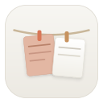
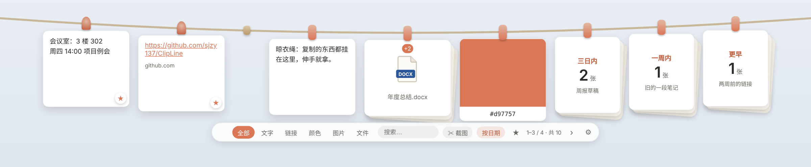

<p align="center">
  
</p>

<h1 align="center">ClipLine 晾衣绳</h1>

<p align="center">
  一根晾衣绳，穿起剪贴板、便签和截图 —— Windows 版<br/>
  <a href="https://github.com/sjzy137/ClipLine/releases/latest"><b>⬇ 下载最新版</b></a> · 免安装 · 4 MB 左右 · 不上传数据 · 无广告
</p>

<p align="center">
  
</p>

复制过的文字、链接、颜色、图片、文件，各自成一张卡片，晾在屏幕顶端的一根绳子上；便签挂在另一根绳上。鼠标顶到屏幕最上沿，绳子就滑下来，左半边是剪贴板绳，右半边是便签绳；鼠标移开，它就收起，不打断手头的事。

## 下载

**👉 [到 Releases 下载最新版](https://github.com/sjzy137/ClipLine/releases/latest)**，两个文件任选其一：

| 文件 | 说明 |
|---|---|
| `ClipLine_x.y.z_portable_x64.exe` | **便携版**：免安装，双击即用，放哪儿都行 |
| `ClipLine_x.y.z_x64-setup.exe` | **安装版**：装到当前用户目录，带开始菜单和卸载 |

- 适用于 Windows 10 / 11（x64），需要系统自带的 WebView2（Win10/11 一般已内置）。
- 装好以后会自己检查更新，一键升级，不必再回这里下载（v1.5.0 起）。
- 每个版本更新了什么，看 [CHANGELOG.md](CHANGELOG.md)，程序里 设置 → 关于 →「更新历史」也能看。

## 功能一览

**剪贴板绳**
- 自动收集复制的文字、链接、颜色、图片、文件；同样的内容不会重复挂，而是移到最前。
- 单击复制，双击编辑或打开，右键看更多操作；按住卡片顶部的夹子左右拖动可以排序。
- 卡片可以拖出：文字拖到输入框直接插入，拖到文件夹生成 .txt / .md；文件拖出默认是复制，按住 Shift 拖是移动。
- 从资源管理器把文件拖到屏幕顶端，绳子会滑下来接住；还可以**监听文件夹**，新文件自动上绳。
- **收藏区**固定在左端；**今天**的卡片散挂在中间；更早的自动折成「三日内 / 一周内 / 更早」三叠。
- 多个文件挂成一叠，可以展开后单独复制或拖出；文件按类型显示彩色图标。
- **链接备注**：给链接卡写一句话（最多 100 字），一眼认出是什么网址，搜索也能搜到。
- **整理**：一键取下原文件已经不在的卡片，可以撤销。

**截图 · 标注 · 识别文字**
- `Ctrl+Alt+S` 框选截图，可直接挂上绳、标注、识别文字或钉在桌面；支持多显示器和高分屏。
- 标注工具：画笔、箭头、方框、椭圆、文字、马赛克、序号。
- OCR 用的是 Windows 自带的文字识别：不联网，也不用下载模型。

**便签绳**
- 第一行是标题；支持 **Markdown**（粗体、标题、列表、引用、代码、链接……）和**待办清单**，卡片上直接打勾。
- 内容长了，卡片底部渐隐并标出「还有 N 行」，鼠标停在上面用滚轮看下文；**单击**打开阅读视图看全文，**双击**编辑。
- 七种底色；可设一次或重复的提醒（每天 / 每周 / 每月），到点在右下角弹出提醒卡片。

**其它**
- 五套主题、四种强调色，可以自由搭配；托盘图标有 5 种颜色可选；字体、字号可调。
- **多显示器**：绳子跟着鼠标所在的屏幕放下，也可固定在主显示器或某一块屏幕。
- 快捷键可以自定义；开机自启；中文 / English / 跟随系统。
- **自动更新**：从 GitHub 发布页检查新版本，可选有新版时提醒、自动下载，或关闭；更新后第一次启动会告诉你这次更新了什么。
- 数据只存在本机：`%APPDATA%\com.clipline.app`，设置里有「打开数据文件夹」按钮。

详细用法见 [使用说明.md](使用说明.md)。

## 常用操作

| 操作 | 方式 |
|---|---|
| 呼出剪贴板绳 / 便签绳 | 鼠标顶到屏幕上沿左半 / 右半，或 `Ctrl+Alt+C` / `Ctrl+Alt+N` |
| 截图上绳 | `Ctrl+Alt+S`，或底部栏「✂ 截图」 |
| 收起 | 鼠标移开、`Esc`，或再按一次快捷键 |
| 复制一张卡 | 单击 |
| 看一张便签的全文 | 单击便签（双击是编辑） |
| 收藏 | 悬停卡片，点右下角 ☆ |
| 移动文件 | 开始拖动时按住 Shift（可在设置里改成 Alt 或 Ctrl） |

## 隐私

ClipLine 不上传任何内容、不需要账号。剪贴板内容、便签、截图只保存在你自己的电脑上，删除 `%APPDATA%\com.clipline.app` 文件夹即可彻底清除。

唯一的联网是**检查更新**：向 GitHub 查询最新发布的版本号，有新版时再从 GitHub 下载安装文件，不发送任何你的数据。设置 → 常规 →「自动更新」选「关闭」即可完全不联网（之后仍可手动检查）。

## 从源码构建

需要 Rust 工具链（MSVC）和 Visual Studio C++ 生成工具。

```powershell
cd src-tauri
cargo build --release          # 便携版：target\release\clipline.exe
# 或：npm i -g @tauri-apps/cli@2 && tauri build   # 同时生成安装包
```

推送版本号后，也可以在 Actions 里运行 **Release** 工作流，自动编译并发布。接手开发请先看 [docs/DEVELOPMENT.md](docs/DEVELOPMENT.md)。

## 支持作者

ClipLine **永久免费**：源码开放、无广告、无账号、不上传数据，个人用、公司用都不必付费。

如果它确实替你省了事，可以扫下面的码请我喝杯茶：

<p>
  
  &nbsp;&nbsp;&nbsp;
  
</p>
<p><sub>左：微信　右：支付宝</sub></p>

打赏完全自愿。它不会解锁任何功能，因为所有功能本来就都给你；也不换来「优先处理」，issue 一视同仁地看。

## 致谢与许可

- 灵感来自 macOS 应用 Clothespeg（Apache-2.0）及其上游 Tendedero（MIT）；截图、标注、OCR 的功能取舍参考了 [截图吧](https://github.com/1003129155/jietuba)（MIT）。ClipLine 为独立重写，名称与图标均为原创，详见 [NOTICE.md](NOTICE.md)。
- 本项目以 [Apache-2.0](LICENSE) 许可发布。

---

<sub>English: ClipLine is a lightweight Windows clipboard manager and sticky-notes app with a clothesline metaphor — cards hang on a rope that drops from the top edge of the screen. Includes region screenshots with annotation and offline OCR, Markdown notes with to-do lists and reminders, multi-monitor support and built-in updates. Portable single exe (~4 MB), no accounts, nothing uploaded. Interface in Chinese and English; see <a href="CHANGELOG.en.md">CHANGELOG.en.md</a>. Built with Tauri (Rust + WebView2).</sub>
