# ClipLine 晾衣绳 · 使用说明

一根晾衣绳，穿起剪贴板、便签和截图。复制过的东西各自成一张卡，晾在屏幕顶端的绳子上；便签挂在另一根绳上。随用随取，不占常驻窗口。

本说明对应 v1.7.0。每个版本更新了什么见 [CHANGELOG.md](CHANGELOG.md)，程序里 设置 → 关于 →「更新历史」也能看。

**目录**

1. [下载与安装](#一下载与安装)
2. [呼出与收起](#二呼出与收起)
3. [剪贴板绳](#三剪贴板绳)
4. [文件卡与拖拽](#四文件卡与拖拽)
5. [绳子的布局：收藏区 · 今天 · 按日期折叠](#五绳子的布局收藏区--今天--按日期折叠)
6. [截图 · 标注 · 识别文字](#六截图--标注--识别文字)
7. [便签绳](#七便签绳)
8. [提醒](#八提醒)
9. [多显示器](#九多显示器)
10. [设置](#十设置)
11. [自动更新与更新历史](#十一自动更新与更新历史)
12. [托盘菜单](#十二托盘菜单)
13. [数据与隐私](#十三数据与隐私)
14. [常见问题](#十四常见问题)

---

## 一、下载与安装

到 [Releases](https://github.com/sjzy137/ClipLine/releases/latest) 下载，两个文件任选其一：

- `ClipLine_x.y.z_portable_x64.exe`：**便携版**，免安装，双击即用，可以放在任何文件夹里。
- `ClipLine_x.y.z_x64-setup.exe`：**安装版**，装到当前用户目录，有开始菜单快捷方式和卸载程序。

适用于 Windows 10 / 11（x64），需要系统自带的 WebView2（Win10/11 一般已内置）。

启动后 ClipLine 待在托盘里，没有主窗口。想开机自动运行：设置 → 常规 →「开机自启动」。

---

## 二、呼出与收起

**呼出：**
- **顶边悬停**：把鼠标移到屏幕最上沿停一下——
  - 停在**左半** → 剪贴板绳滑下来；
  - 停在**右半** → 便签绳滑下来；
  - 按住**翻转键**（默认 Shift）时左右对调。
  - 停顿时长可选 0.15 / 0.25 / 0.4 秒，也可以整个关掉顶边悬停（设置 → 呼出方式）。
- **快捷键**（可在设置里改）：`Ctrl+Alt+C` 剪贴板绳，`Ctrl+Alt+N` 便签绳，`Ctrl+Alt+S` 截图。
- **托盘图标**：左键单击放下剪贴板绳；右键是完整菜单。

**收起：** 鼠标移开片刻、点绳子外的空白处、再按一次对应快捷键，或按 `Esc`。打开了编辑框、阅读视图或菜单时，绳子不会自己收起。

**底部栏**（从左到右）：类型筛选（全部 / 文字 / 链接 / 颜色 / 图片 / 文件）、搜索、「✂ 截图」、「整理」（有失效卡片时才出现）、「按日期」、★ 只看收藏、页码、翻屏按钮、⚙ 设置。在绳子空白处滚动鼠标滚轮也能翻屏。

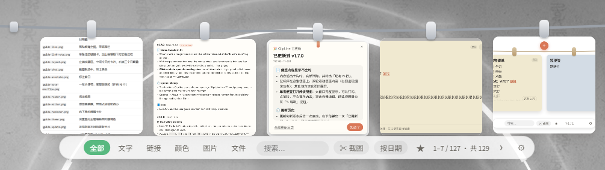

---

## 三、剪贴板绳

复制任何文字、链接、颜色值、图片或文件，它就自动挂上绳，每条成一张卡：

- **文字卡 / 代码卡**：显示复制时的原样（不做 Markdown 渲染），代码用等宽字体。
- **链接卡**：显示网址与域名，可以加备注（见下文）。
- **颜色卡**：卡面直接显示这个颜色，支持 `#hex`、`rgb()`、`hsl()`。
- **图片卡**：显示缩略图。用 PrintScreen 或 Win+Shift+S 截的图进了剪贴板，也会自动上绳。
- **文件卡**：见下一节。

同样的内容再次复制时，不会挂第二张，而是把原来那张移到最前。剪贴板绳最多保留 300 张（收藏的不算在内）。

**卡片操作：**

| 操作 | 效果 |
|---|---|
| 悬停 | 卡片浮起，露出左上 ✕（取下）、右上 🔍（预览）、右下 ☆（收藏） |
| 单击 | 复制到剪贴板，卡上浮现「已复制」 |
| 双击 | 文字卡：放大编辑（`Ctrl+S` 保存，`Esc` 关闭）；图片卡：复制并收起绳子；文件卡：打开 |
| 拖动卡片 | 拖出到别的程序（见下一节） |
| 拖动顶部的夹子 | 左右调整顺序，其它卡片会让位 |
| 右键 | 更多操作，随卡片类型不同：复制、编辑文字、粘贴到原应用、在浏览器打开、添加备注、转为便签、保存到桌面、标注、识别文字、打开、在资源管理器中显示、复制文件地址、收藏、取下 |

**🔍 预览**：文字卡在大框里显示全文，可以选中、滚动；图片卡打开一个钉在桌面的浮动窗口，滚轮缩放、可拖动，`Esc` 关闭，窗口上还有「标注」「识别」按钮。

**粘贴到原应用**：右键文字卡「粘贴到原应用」，绳子收起，文字直接粘到你刚才在用的那个程序里。

**转为便签**：右键文字卡「转为便签」，把这段文字变成一张可以编辑、可以设提醒的便签。

**链接备注**：右键链接卡「添加备注」，或双击链接卡在编辑框下方填写，最多 100 字（例如「报销系统登录页」）。备注显示在卡片最上方（最多两行，悬停看全文），日期叠里的小卡也显示；搜索能搜到备注；同一链接再次复制时备注保留。

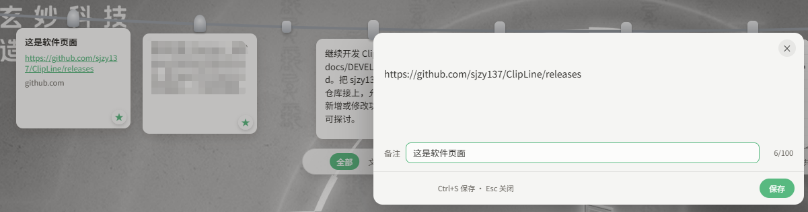

**收藏**：悬停卡片点右下角 ☆（或右键「收藏」），变成 ★。收藏的卡片固定在绳子左端，不会被自动清理；底部 ★ 按钮可以只看收藏。

**自动清理**：剪贴板卡片默认保留 30 天（设置 → 自动清理，可选 7 / 14 / 30 / 90 天），收藏的除外。便签不会被自动清理。

---

## 四、文件卡与拖拽

- **复制文件 / 文件夹**（在资源管理器里 `Ctrl+C`）即自动挂上绳，成一张文件卡。
- **文件类型一眼可辨**：图标带颜色和扩展名——Word 蓝、Excel 绿、PPT 橙、PDF 红、图片紫、视频粉、音频黄、压缩包棕、代码深灰、文本浅灰、程序黑；文件夹显示文件夹图标。原文件被移走或删除后，卡片变灰。
- **一叠文件**：一次复制多个文件，会挂成一叠（卡片后面露出几层，中间上方显示 +N）。点 +N、右上角 ☰ 或双击展开：单击某个文件只复制它，拖出某个文件只拖它，双击打开；「拆成单张」把这一叠拆成独立的卡。直接拖整张卡则是全部文件一起拖。
- **拖出**：按住文件卡或图片卡往外拖，松手即把文件**复制**到目标（聊天窗口、邮件、文件夹等）。**开始拖时按住 Shift = 移动**（拖动开始后可以松开 Shift），移走后卡片自动取下。想换成 Alt 或 Ctrl：设置 → 呼出方式 →「拖出卡片时『移动』用的按键」。
- **文字卡拖出**：拖到资源管理器或桌面，生成一个 .txt 文件（设置里可改成 .md）；拖到任何输入框，直接插入文字。
- **拖入**：把文件从资源管理器或桌面拖到已经放下的绳子上，松手即挂上。
- **拖到屏幕顶端自动接住**：拖着文件把鼠标顶到屏幕**最上沿**停一下，绳子会滑下来，出现虚线框「松手挂上绳」，移进框里松手即挂。偶尔鼠标显示禁止符号也没关系，照样松手。拖窗口、拖网页文字不会触发。不想要可以在 设置 → 呼出方式 里关闭。
- **监听文件夹**：设置 → 监听文件夹 →「添加文件夹」。之后这些文件夹里**新出现的文件**会自动挂上绳（已经在里面的文件不会挂）。适合「下载」文件夹、截图保存文件夹。
- **取下（删除原文件）**：文件卡右键，确认后把原文件**移到回收站**（可以从回收站恢复），同时取下卡片。普通「取下」只移除卡片，不动原文件。

> 网页里的图片还不能直接拖上绳（浏览器拖出的不是真实文件），可以先右键复制图片，它会自动上绳。

---

## 五、绳子的布局：收藏区 · 今天 · 按日期折叠

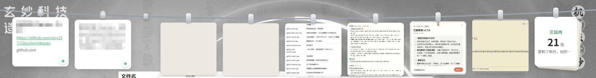

- **收藏区（左端）**：收藏的卡片固定挂在最左边，和其它卡片之间隔着一个小木扣，翻页时不动。最多 3 个位置，收藏超过 3 张时第 3 位变成「★ 其余收藏 N 张」一叠。拖动收藏卡的夹子可以调整先后。切换到「文字 / 链接 / 图片…」等分类时，左端只显示该分类里的收藏。
- **今天**：今天（0 点以后）复制的卡片按时间散挂在中间，最新的在前；多了就翻页。
- **按日期折叠**（默认开启）：更早的卡片自动折成「三日内 / 一周内 / 更早」三叠挂在右端。点一叠展开，里面每张卡片都能单击复制、拖出、双击编辑或打开、右键更多；悬停点 ✕ 取下单张，「全部取下」清空这一叠，都可以撤销。底部「按日期」按钮随时切换成全部散挂，设置 → 呼出方式 里也有开关。
- **整理**：有卡片的原文件不在了（卡片变灰），底部会出现「整理 N」；点一下，这些卡片掉落取下，5 秒内可以点「撤销」。收藏的卡片不会被整理。
- 搜索或「只看收藏」时，结果平铺显示，不分区、不折叠。

---

## 六、截图 · 标注 · 识别文字

**截图上绳**：按 `Ctrl+Alt+S`（设置 → 快捷键里可改，清空即关闭），或点底部栏「✂ 截图」、托盘菜单「截图上绳」。屏幕定格变暗，拖动框选区域（右键或 `Esc` 取消），松手后出现工具条：

- **✓ 挂上绳**（也可按 Enter 或双击选区）：截图挂成图片卡，同时已复制，可以直接粘贴；
- **✎ 标注**：挂上绳并打开标注窗口；
- **文 识别文字**：挂上绳并识别其中的文字；
- **📌 钉在桌面**：挂上绳并钉在桌面上。

支持多显示器、高分屏，截的是实际像素。截图进行中，顶边悬停和拖拽接住会暂停。

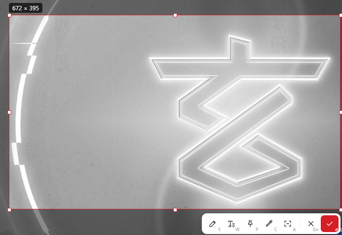

**标注**：图片卡右键「✎ 标注」，或钉图、截图工具条上的「标注」。

- 工具：画笔、箭头、方框、椭圆（按住 Shift 画正方形 / 正圆）、文字（点一下输入，Enter 确定）、马赛克、序号 ①②③；
- 7 种颜色，细 / 中 / 粗三档；
- `Ctrl+Z` 撤销，`Ctrl+Y` 重做；快捷键 P / A / R / E / T / M / N 切换工具；
- 点「✓ 完成」（或 `Ctrl+S`）保存为一张**新的**图片卡并复制，原图保留。

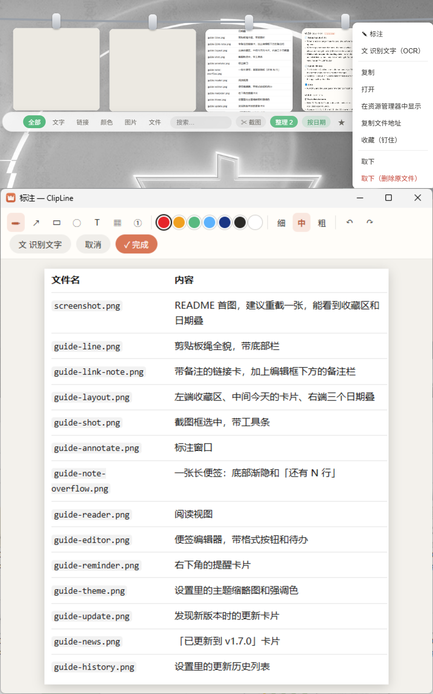

**识别文字（OCR）**：图片卡右键「文 识别文字」，或标注窗口、钉图、截图工具条上的「识别」。用的是 Windows 自带的文字识别，不联网、不用下载模型。识别结果挂成一张文字卡并复制，同时打开编辑框方便核对。

- 需要系统装有对应语言的识别组件。中文系统一般自带；若提示「未安装可用的 OCR 语言」，到 Windows 设置 → 时间和语言 → 语言和区域，在中文（或英文）的「语言选项」里添加「光学字符识别」。
- 小字号的截图会自动放大后再识别，效果更好。

---

## 七、便签绳

点绳子**中间上方的 +** 新建便签（也可以用托盘菜单「新建便签」）。第一行自动作为标题。

**查看便签：**

| 操作 | 效果 |
|---|---|
| 单击便签 | 打开**阅读视图**：大框完整显示，能打勾、点链接，不会误改内容；右上「✎ 编辑」转去编辑 |
| 双击便签 | 编辑 |
| 鼠标停在显示不全的便签上滚动滚轮 | 滚动这张便签的内容（右侧出现细滚动条）；鼠标在别处时滚轮照旧翻屏 |
| 点方框 | 打勾 / 取消 |
| 点链接 | 在浏览器打开 |
| 悬停 | 露出左上 ✕（完成，放进篮子）、右上 ✎（编辑）、右下 ☆（收藏） |
| 右键 | 收藏、完成（放进篮子）、删除（不进篮子） |
| 拖动顶部的夹子 | 调整顺序 |

内容超出卡片时，卡片底部渐隐，右下角标出「还有 N 行」（按显示的行数算，一段自动折行的长文字算一行），点它也能打开阅读视图。

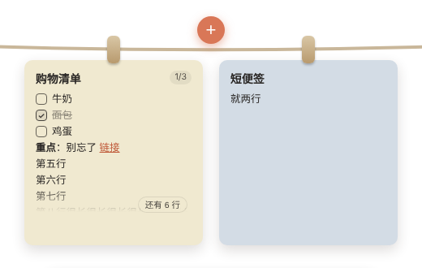

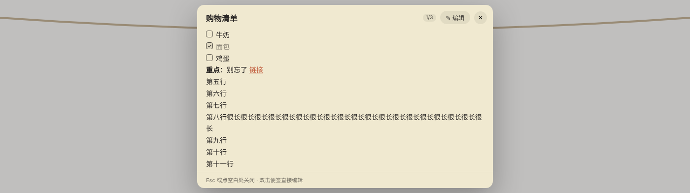

**编辑器：**
- 左上角选**分类**（见下文）；`Ctrl+S` 保存，`Esc` 保存并关闭；内容清空后关闭即删除这张便签。
- **待办清单**：点「☑ 待办清单」，把当前行（或选中的几行）变成待办，再点一次取消；也可以直接输入 `- [ ] `、`[ ] ` 或 `[] ` 开头。写完一项按回车自动接下一项，空着再按一次回车结束清单；`Tab` / `Shift+Tab` 缩进。卡片标题右边显示完成进度（如 2/5，全部完成变绿）。
- **Markdown**：`**粗体**`、`*斜体*`、`~~删除线~~`、`# 标题`、`- 列表`、`1. 编号`、`> 引用`、`` `代码` ``、`[文字](网址)`、`---` 分隔线；编辑器上方有对应按钮，`Ctrl+B` / `Ctrl+I` 加粗 / 斜体。「👁 预览」先看效果，预览里也能打勾。
- 底部 🔔 设提醒（见下一节）。

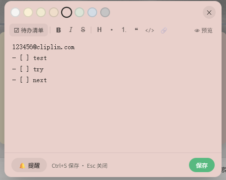

收藏的便签排在最前。绳上的便签不会被自动清理。

**分类：** 每张便签属于一个分类，分类带颜色，便签的底色就是分类的颜色。预设七个：工作、待办、灵感、生活、资料、稍后看、要紧；没选的是「未分类」。编辑器左上角点分类名切换；菜单最下面「管理分类…」可以改名、删除、新建（新建时从剩下的颜色里挑一个，最多 11 个分类）。删除分类不会删除便签，只是改为未分类。以前选过底色的便签，按颜色自动归入对应分类。

便签绳用了两种以上分类时，底部栏左边出现分类筛选：「全部」和正在用的各个分类，点一个只看这一类；右键筛选按钮也能打开「管理分类」。

**篮子（已完成的便签）：** 绳子右端挂着一只篮子，角标是篮子里的便签数。
- 便签上点 ✕，或右键「完成，放进篮子」，便签连同它的待办放进篮子，记下完成时间；5 秒内可以撤销。只想丢掉不留记录的，用右键「删除（不进篮子）」。
- 有待办全部打勾的便签时，底部栏出现「整理 N」，点一下把它们一起放进篮子（收藏的不动）。
- 点篮子打开「已完成的便签」：最上面是本月统计（如「本月完成 12 张 · 47 项 · 工作 8」，「项」是打勾的待办数），下面按月分组，每月也有自己的统计。悬停一条可以「↩ 放回绳上」或 ✕ 删除；右上角「清空篮子」（点两次确认）。
- 篮子里的便签默认保留 30 天，设置 → 自动清理 里可改为 7 / 30 / 90 / 365 天或永久。

> 小技巧：剪贴板文字卡右键「转为便签」，复制来的文字直接变成便签。

---

## 八、提醒

在便签卡片底部的 🔔，或编辑器底部的 🔔，打开提醒面板：

- 快捷时间：默认「15 分钟后」「1 小时后」「明天此时」，可在 设置 → 提醒快捷项 里从 11 项中自选；
- 也可以选具体的日期和时间；
- 重复：不重复 / 每天 / 每周 / 每月；
- 「清除」取消提醒。

设了提醒的便签，底部一直显示一枚小标签，如「🔔 下次 11-04 09:00」，重复周期在第二行，点它可修改。

**到点时**，屏幕右下角弹出一张便签样式的提醒卡片，伴随提示音（绳子收着也能看到）。卡片不会自动消失：

- 「知道了」：结束这次提醒（重复提醒会按周期继续）；
- 「10 分钟后再提醒」：稍后再弹；
- 「打开便签」：放下便签绳并打开这张便签编辑。

多个提醒同时到点时，卡片依次往上叠。

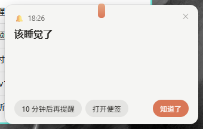

---

## 九、多显示器

设置 → 呼出方式 →「晾衣绳出现在」：

- **跟随鼠标**（默认）：在哪块屏幕的顶边呼出，或按快捷键时鼠标在哪块屏幕，绳子就在哪块屏幕放下；
- **主显示器**：始终在主显示器放下，其他屏幕的顶边不再触发；
- **指定显示器**：列出当前连接的每块屏幕（编号、分辨率、缩放比例），选定后固定在那一块。

不同缩放比例（100% / 125% / 150% …）的屏幕混用时，绳子按所在屏幕重新排布，卡片大小保持一致。选定的显示器拔掉时自动改用主显示器；绳子放下时所在屏幕被拔掉，会自动收起。提醒卡片、更新卡片弹在同一块屏幕的右下角。

---

## 十、设置

底部栏右端 ⚙，或托盘菜单「设置」。改完点「保存」生效，「取消」放弃。

- **快捷键**：剪贴板绳、便签绳、截图上绳。点输入框后按下组合键即可录制；「恢复默认」；组合键被占用会提示。
- **呼出方式**：顶边悬停开关、停顿时长、左右翻转键（关闭 / Shift / Ctrl / Alt）、拖文件到屏幕顶部自动放绳、拖出卡片时「移动」用的按键、按日期折叠、文字卡片拖到文件夹时保存为 .txt / .md、晾衣绳出现在哪块屏幕。
- **自动清理**：剪贴板卡片保留 7 / 14 / 30 / 90 天；篮子里已完成的便签保留 7 / 30 / 90 / 365 天或永久（默认 30 天）。
- **常规**：语言（跟随系统 / 中文 / English；跟随系统时，Windows 显示语言为中文则用中文，其他用英文）、开机自启动。
- **主题**：五套外观——柔彩日常、经典银灰、棉麻木夹、奶白轻盈、石墨金属（夹子和绳子样式不同），以缩略图预览，点选即时在绳子上看到效果；**强调色**（按钮、角标等的颜色）：陶土橙、薄荷绿、晴空蓝、深海蓝，和主题自由搭配；**托盘图标**：陶土橙、百事蓝、徕卡红、晴空蓝、薄荷绿（exe 图标固定为陶土橙）。
- **字体**：系统默认 / 微软雅黑 / 等线 / 思源黑体 / 宋体 / 楷体 / 仿宋，字号小 / 中 / 大。
- **提醒快捷项**：勾选提醒面板里显示的快捷时间（5 分钟后到下周此时共 11 项）。
- **监听文件夹**：添加、移除要监听的文件夹。
- **使用说明**：常用操作速查。
- **关于**：数据文件夹（「打开数据文件夹」）、当前版本与「检查更新」、**「更新历史」**、自动更新方式。

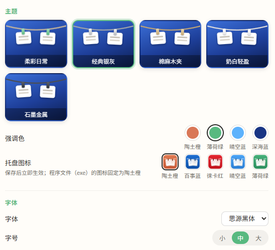

---

## 十一、自动更新与更新历史

**检查更新**：ClipLine 会从 GitHub 发布页检查新版本——启动约半分钟后一次，之后每 6 小时一次。在 设置 → 关于 →「自动更新」里选：

- **有新版时提醒**（默认）：发现新版本时，右下角弹出一张卡片，写着新版本号和更新内容，可选「立即更新」「以后再说」「跳过此版本」（跳过的版本不再提醒，有更新的版本时照常提醒）；
- **自动下载**：后台把新版本下好，再弹卡片问一次：「重启并更新」马上更新；「稍后」的话，下次从托盘退出 ClipLine 时自动安装；
- **关闭**：不自动检查。

随时可以手动检查：托盘菜单「检查更新」，或 设置 → 关于 →「检查更新」。手动检查时，跳过的版本也会显示。

更新时 ClipLine 自动关闭，换成新版本后再自动打开，卡片、便签和设置都不受影响：

- **安装版**：以免打扰方式运行新版安装程序（只有一个进度条，不用点任何按钮），开机自启动的设置保留；
- **便携版**：直接替换当前这个 exe，**文件名和位置都不变**（所以文件名里的版本号可能是旧的，以 设置 → 关于 里显示的为准）；桌面快捷方式和开机自启动照常可用。exe 放在没有写入权限的文件夹里时，会提示你到发布页手动下载。

连不上 GitHub 时，卡片会说明原因，可以点「打开发布页手动下载」。v1.4.0 及更早的版本没有这个功能，需要手动下载一次新版。

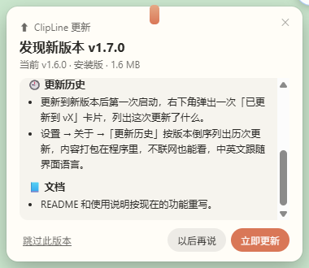

**更新历史**：

- 更新到新版本后**第一次启动**，右下角弹出一次「已更新到 vX」卡片，列出这次更新了什么；点「全部更新历史」看以往各版本，点「知道了」关闭。新安装的不会弹。
- 设置 → 关于 →「更新历史」→「查看」：按版本倒序列出历次更新。内容打包在程序里，不联网也能看；中英文跟随界面语言。

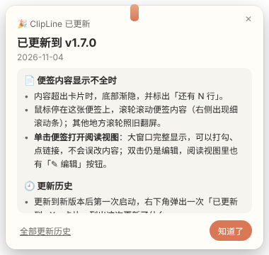&nbsp;&nbsp;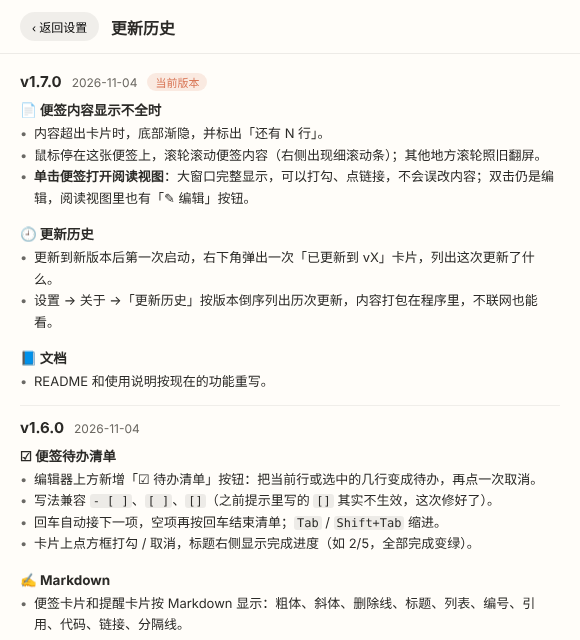

---

## 十二、托盘菜单

左键单击托盘图标放下剪贴板绳。右键菜单（跟随设置里的语言显示中文或英文）：

- 剪贴板绳 / 便签绳 / 新建便签
- 暂停 / 恢复监控：暂停期间复制的东西不会上绳（适合复制密码等）
- 设置
- 截图上绳
- 检查更新
- 重启 / 退出

---

## 十三、数据与隐私

- 所有卡片、便签、设置和图片都存在本机 `%APPDATA%\com.clipline.app`（设置 → 关于 →「打开数据文件夹」一键打开）。删除这个文件夹即彻底清空。
- ClipLine 不上传任何内容、不需要账号。唯一的联网是检查更新：向 GitHub 查询版本号、下载安装文件，不发送你的数据；「自动更新」选「关闭」即可完全不联网（仍可手动检查）。

---

## 十四、常见问题

- **绳子不出来**：看看托盘图标还在不在；顶边悬停是否被关掉了（设置 → 呼出方式）；多显示器时是不是固定在了另一块屏幕。
- **快捷键没反应**：可能被别的程序占用了，到 设置 → 快捷键 换一个组合。
- **识别文字提示缺少语言**：见第六节，添加 Windows 的「光学字符识别」组件。
- **便携版更新后文件名还是旧版本号**：正常，以 设置 → 关于 里的版本号为准。
- **想反馈问题**：在 exe 旁边新建一个空文件 `clipline-debug.log`，程序会把诊断信息写进去，反馈时附上；不用时删掉即可。

---

从源码构建见 [README.md](README.md)；接手开发见 [docs/DEVELOPMENT.md](docs/DEVELOPMENT.md)。
